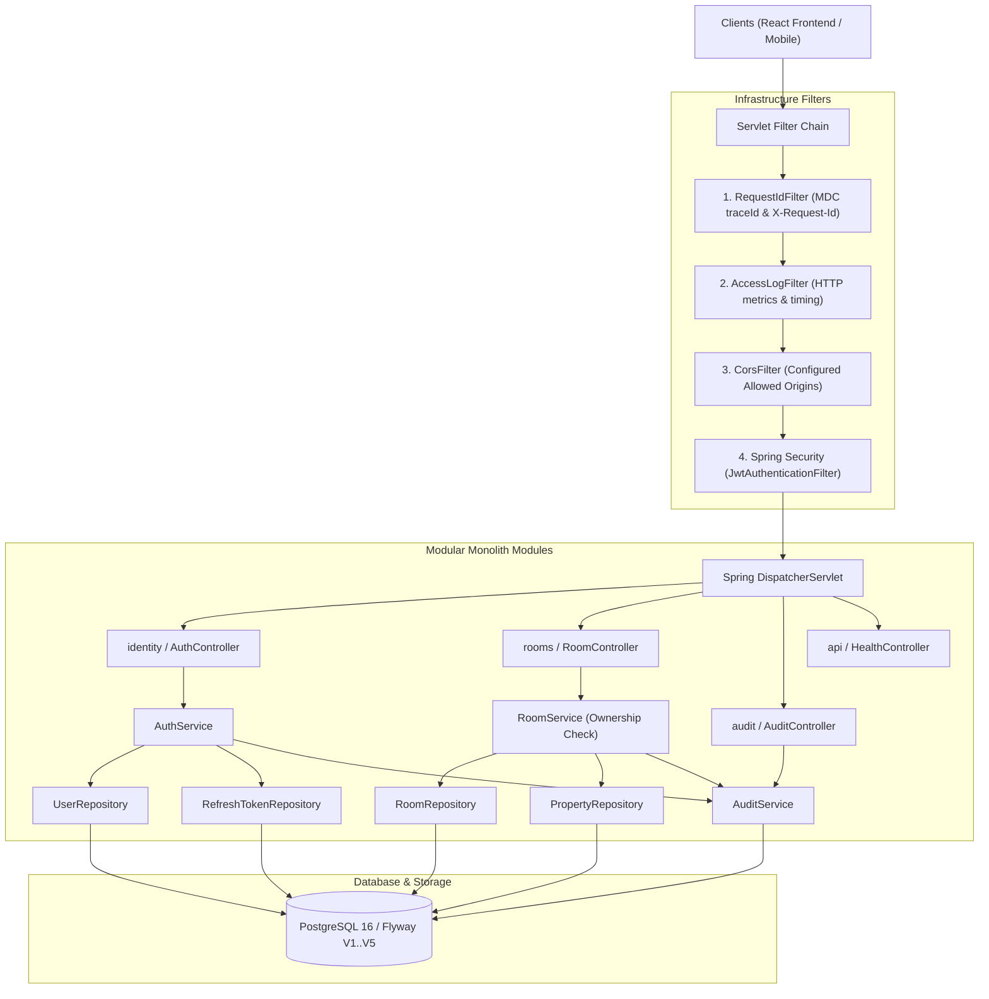

# Tài liệu Kiến trúc Backend RentFlow (Enterprise Modular Monolith)

Tài liệu này định nghĩa chi tiết kiến trúc, quy tắc phân lớp, luồng xử lý HTTP request, mô hình bảo mật và hướng dẫn mở rộng cho Backend của **RentFlow** (Java 17/21 + Spring Boot 3 + PostgreSQL).

---

## 1. Tổng quan Kiến trúc Modular Monolith

RentFlow Backend được tổ chức theo kiến trúc **Modular Monolith kết hợp Domain-Driven Design (DDD) thực dụng**. Mỗi nghiệp vụ cốt lõi là một module khép kín có ranh giới rõ ràng:



---

## 2. Thứ tự Filter và Vòng đời Request (Request Lifecycle)

Một request gửi tới RentFlow Backend trải qua các giai đoạn sau:

1. **`RequestIdFilter` (`Ordered.HIGHEST_PRECEDENCE`):**
   - Trích xuất `X-Request-Id` từ client nếu hợp lệ (regex alphanumeric, tối đa 64 ký tự), hoặc tự sinh UUID mới.
   - Thiết lập `requestId` vào SLF4J MDC và `RequestContext` (ThreadLocal).
   - Đặt header `X-Request-Id` vào response để hỗ trợ tracing.
   - Khối `finally` bảo đảm dọn sạch MDC và ThreadLocal, chống rò rỉ context khi dùng thread pool.
2. **`AccessLogFilter` (`Ordered.HIGHEST_PRECEDENCE + 1`):**
   - Đo thời gian xử lý chính xác (ms).
   - Ghi log HTTP metadata: `[HTTP] METHOD URI -> STATUS (duration ms) [traceId: ...]`.
   - Tuyệt đối không log Authorization Header hoặc request body nhạy cảm.
3. **`CorsFilter` (`CorsConfigurationSource`):**
   - Xử lý preflight `OPTIONS` và kiểm tra domain được cấu hình trong `rentflow.cors.allowed-origins`.
4. **`JwtAuthenticationFilter` (trước `UsernamePasswordAuthenticationFilter`):**
   - Trích xuất Bearer Token từ header `Authorization`.
   - Xác thực chữ ký bí mật HMAC-SHA256 và thời hạn token.
   - Nạp `AuthenticatedUser` và `GrantedAuthority (ROLE_ADMIN, ROLE_LANDLORD, ROLE_TENANT)` vào `SecurityContextHolder`.
5. **Spring Security Authorization (`SecurityFilterChain`):**
   - Cho phép các route công khai (`/api/v1/auth/**`, `/api/v1/health/**`, `/v3/api-docs/**`, `/swagger-ui/**`).
   - Bắt buộc xác thực cho toàn bộ các route còn lại.
   - Nếu chưa xác thực: trả HTTP 401 JSON qua `RestAuthenticationEntryPoint`.
   - Nếu không đủ quyền: trả HTTP 403 JSON qua `RestAccessDeniedHandler`.
6. **Controller Layer:**
   - Tiếp nhận request, kiểm tra cú pháp đầu vào qua Jakarta Bean Validation (`@Valid`).
   - Kiểm tra quyền mức phương thức (`@PreAuthorize`).
7. **Application Service Layer:**
   - Đảm nhận ranh giới `@Transactional`.
   - Kiểm tra **Resource Ownership** (Ví dụ: Chủ trọ chỉ có quyền thao tác trên cơ sở/phòng thuộc quyền sở hữu của mình).
   - Phối hợp giữa Domain Entity, Repository và ghi nhận **Audit Log**.
8. **Infrastructure Layer:**
   - Spring Data JPA thực thi câu lệnh SQL trên PostgreSQL.
9. **Global Exception Handler (`@RestControllerAdvice`):**
   - Đón bắt `MethodArgumentNotValidException`, `ResourceNotFoundException`, `BusinessException`, `AccessDeniedException`.
   - Đóng gói phản hồi lỗi thống nhất `ErrorResponse` kèm `requestId`, mã lỗi `code` và thời điểm phát sinh.

---

## 3. Ranh giới Nghiệp vụ giữa các Module

| Module | Trách nhiệm chính | Thành phần cốt lõi |
|---|---|---|
| **`identity`** | Xác thực danh tính, cấp/xoay vòng JWT tokens, mã hóa mật khẩu BCrypt | `AuthService`, `JwtTokenProvider`, `RefreshToken` |
| **`users`** | Hồ sơ tài khoản, vai trò (ADMIN, LANDLORD, TENANT), trạng thái tài khoản | `User`, `UserRepository`, `UserRole`, `UserStatus` |
| **`properties`** | Cơ sở trọ / toà nhà cho thuê, liên kết chủ sở hữu `landlord_id` | `Property`, `PropertyRepository` |
| **`rooms`** | Danh mục phòng trọ, giá thuê, diện tích, trạng thái khả dụng | `Room`, `RoomRepository`, `RoomService`, `RoomController` |
| **`audit`** | Nhật ký kiểm toán các hành vi quan trọng (Audit Logs) độc lập với application log | `AuditLog`, `AuditLogRepository`, `AuditService` |

---

## 4. Quy tắc Phát triển và Code Review

1. **Controller không chứa logic nghiệp vụ:** Controller chỉ nhận request DTO, validate và trả về response DTO bọc trong `ApiResponse<T>`.
2. **Không trả Entity JPA trực tiếp ra API:** Mọi kết quả phải được chuyển đổi sang DTO rõ ràng.
3. **Không truy cập Repository của module khác tùy tiện:** Giao tiếp liên module phải thông qua Application Service hoặc Event/Read Model của module đó.
4. **Không log dữ liệu nhạy cảm:** Không ghi mật khẩu, OTP, Access Token, Refresh Token vào console/file logs.
5. **Quản lý Schema duy nhất bằng Flyway:** Cấu hình Hibernate luôn là `ddl-auto: validate`. Mọi thay đổi schema đều phải tạo file migration mới (`V6__...sql`).
6. **Kiểm tra quyền sở hữu dữ liệu (Tenant Isolation):** Không bao giờ tin tưởng `userId` do client gửi lên; luôn lấy ID người dùng đã xác thực từ `SecurityUtils.getCurrentUserId()`.

---

## 5. Hướng dẫn Bổ sung Module Nghiệp vụ Mới (How-To Guide)

Khi cần phát triển một module mới (ví dụ: `invoices` hoặc `contracts`):

1. **Bước 1: Xác định ranh giới & quan hệ dữ liệu**
   - Xác định entity thuộc module và các khóa ngoại liên kết tới `properties`, `rooms` hoặc `users`.
2. **Bước 2: Tạo Flyway Migration**
   - Tạo file `V<N>__create_<module>_table.sql` trong `backend/src/main/resources/db/migration/`.
   - Khai báo rõ Primary Key (UUID), Foreign Keys, Unique constraints, Indexes.
3. **Bước 3: Viết Domain & Persistence**
   - Tạo package `vn.rentflow.modules.<module-name>.domain`.
   - Tạo JPA Entity khớp chính xác với migration table.
   - Tạo `infrastructure/persistence/<Entity>Repository.java`.
4. **Bước 4: Viết DTO & Application Service**
   - Tạo DTO request (có validation `@NotNull`, `@NotBlank`) và response.
   - Tạo `<Entity>Service.java` với các phương thức `@Transactional`.
   - Kiểm tra Resource Ownership bằng `SecurityUtils.getCurrentUserId()`.
   - Gọi `AuditService.record(...)` cho các hành động quan trọng (tạo, cập nhật, xóa, duyệt).
5. **Bước 5: Tạo Controller**
   - Tạo `<Entity>Controller.java` với đường dẫn `/api/v1/<resource>`.
   - Gắn `@PreAuthorize("hasRole(...)")` hoặc `@PreAuthorize("isAuthenticated()")`.
6. **Bước 6: Viết Test tự động**
   - Viết Unit test cho Service (Mockito).
   - Viết Integration test cho Controller (MockMvc với `@WithMockUser` và kiểm tra database thật).
7. **Bước 7: Chạy kiểm thử toàn bộ**
   ```powershell
   .\mvnw.cmd clean test
   ```
